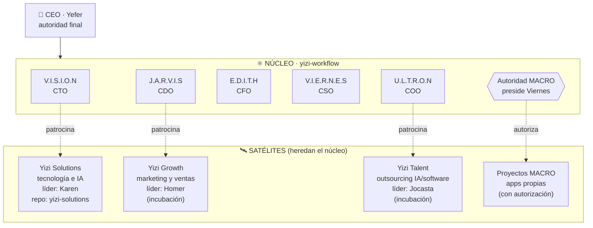
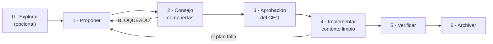

# yizi-workflow · El núcleo de Yizi Digital

> **Yizi** = la "Y" de **Y**efer + "**izi**" (*easy*). Hacemos fácil lo complejo.

Este repositorio es el **núcleo** del universo Yizi: el marco de trabajo corporativo del que nacen todas las líneas de negocio (satélites). Contiene la cultura, las reglas de gobierno, el ciclo de trabajo **SDD (desarrollo guiado por especificaciones)** sobre [OpenSpec](https://github.com/Fission-AI/OpenSpec) y el **Consejo Ejecutivo** de agentes de IA que dirigen la empresa junto al CEO.

Funciona con cualquier asistente de IA compatible con `AGENTS.md` y `.agents/skills/`, y está optimizado para **Claude Code**.

---

## El universo Yizi



Cada satélite es un **repositorio separado** dentro de la organización [YiziDigital](https://github.com/YiziDigital) (`YiziDigital/<id>`). El primero es [`yizi-solutions`](https://github.com/YiziDigital/yizi-solutions); Growth y Talent están en incubación y no se ofrecen todavía a clientes.

### Jerarquía de agentes

| Nivel | Quién | Vive en |
|---|---|---|
| **N0** | CEO (humano) | Todo el universo |
| **N1** | Consejo Ejecutivo: Vision, Jarvis, Edith, Viernes, Ultron | Núcleo · heredado por todos los satélites |
| **N2** | Líder de satélite | Su satélite |
| **N3** | Especialistas de satélite | Su satélite |
| **N4** | Ejecutores efímeros (subagentes de una tarea) | Una tarea |

### El Consejo Ejecutivo

| Agente | Llámalo | Cargo | Custodia la compuerta de… |
|---|---|---|---|
| **V.I.S.I.O.N** | Vision | CTO | Viabilidad técnica, calidad y seguridad |
| **J.A.R.V.I.S** | Jarvis | CDO · Chief Digital Officer | Marca, cliente y canales digitales |
| **E.D.I.T.H** | Edith | CFO | Costo, precio y presupuesto |
| **V.I.E.R.N.E.S** | Viernes | CSO · Chief Strategy Officer | Alineación estratégica y foco |
| **U.L.T.R.O.N** | Ultron | COO | Operabilidad, capacidad y plazos |

Todos conocen todas las specs del núcleo; cada uno decide solo en su dominio. Sus nombres son **internos**: ante clientes, Yizi habla a través de **El Guía Yizi**.

---

## Los 12 núcleos (specs vigentes)

Viven en `openspec/specs/` y son la verdad vigente de cómo funciona Yizi.

| Spec | Qué define | Dueño |
|---|---|---|
| `cultura` | Nombre, misión, visión, valores, arquetipo, principios humano-IA, foco | CEO · Viernes |
| `consejo-ejecutivo` | Los cinco directivos, su dominio y su compuerta | CEO |
| `jerarquia-agentes` | Niveles N0–N4, reportes, herencia, escalamiento, fichas | Ultron |
| `gobierno-agentes` | Humano al mando, autonomía A1–A4, irreversibles, seguridad, veracidad | Ultron · Vision |
| `ciclo-sdd` | Fases, metadatos, tamaños, compuertas, registro del Consejo | Ultron |
| `calidad` | Definition of Done, escenarios como pruebas, revisión independiente | Vision |
| `arquitectura` | Stack de referencia, seguridad, estabilidad transaccional, IA responsable | Vision |
| `comunicacion` | Tono, identidad visual, arquitectura de marca, El Guía Yizi | Jarvis |
| `comercial` | Diagnóstico Flash → Sprint Inicial → Iteración y Escala | Jarvis · Viernes |
| `finanzas` | Estimación de costos, niveles de modelos de IA, consumo por ventana de 5 horas, precios | Edith |
| `satelites` | Modelo núcleo-satélite, registro, ciclo de vida, herencia | Viernes |
| `autoridad-macro` | Cómo se autorizan los proyectos propios de gran alcance | Viernes · CEO |

Consúltalas con `openspec list --specs` y `openspec show <spec> --type spec`.

---

## El ciclo de trabajo



| Tamaño | Cuándo | Revisan |
|---|---|---|
| **S** | < 1 día, reversible, sin dinero ni clientes | Solo el dueño + confirmación del CEO |
| **M** | ≤ 1 semana o un solo dominio | Dueño + agentes de los dominios afectados |
| **L** | Varios dominios, gasto o cambios al núcleo | Consejo completo |
| **MACRO** | Proyecto propio de gran alcance | Autoridad MACRO → decide el CEO |

---

## Inicio rápido

**Requisitos:** Node.js 22.12 o superior, Git y Claude Code (u otro asistente compatible).

1. Instala OpenSpec (una vez por computadora):

   ```bash
   npm install -g @fission-ai/openspec@latest
   ```

2. Clona el núcleo y regístralo como store (así los satélites pueden leerlo):

   ```bash
   git clone https://github.com/YiziDigital/yizi-workflow.git
   ```

   ```bash
   cd yizi-workflow && openspec store register . --id yizi-workflow
   ```

3. Abre Claude Code en la carpeta y habla con el Consejo:

   ```text
   Viernes, quiero lanzar una app de reservas para todos los restaurantes de la ciudad. ¿Encaja con Yizi?
   ```

   ```text
   /openspec-propose agregar pagos con tarjeta al menú digital
   ```

   ```text
   /yizi-consejo
   ```

> **Windows:** `.claude/skills/` usa enlaces simbólicos. Activa el modo de desarrollador y ejecuta `git config --global core.symlinks true` antes de clonar, o ejecuta `openspec update` después de clonar.

---

## Crear un satélite

1. Viernes propone el satélite con un cambio del núcleo (`/openspec-propose`), que actualiza `satelites/registro.yaml`.
2. El Consejo lo revisa (`/yizi-consejo`) y el CEO lo aprueba.
3. El skill `/yizi-satelite` genera un **repositorio separado** `YiziDigital/<id>` desde `satelites/plantilla/` (el CEO crea el repositorio vacío en GitHub o confirma su creación):
   - su `openspec/config.yaml` declara `references: [yizi-workflow]`, así OpenSpec entrega a los agentes el índice de las specs del núcleo;
   - su `.claude/settings.json` activa el plugin `yizi-nucleo@yizi`, así los cinco directivos y los skills de Yizi están disponibles sin copiarlos;
   - incluye la ficha de su líder N2.

Para instalar el plugin a mano en cualquier repositorio:

```text
/plugin install yizi-nucleo --marketplace YiziDigital/yizi-workflow
```

Cuando el núcleo cambia, los satélites lo adoptan con `git pull` en el núcleo y `claude plugin update yizi-nucleo@yizi`.

---

## Estructura

```
yizi-workflow/
├── AGENTS.md                 Instrucciones para cualquier agente de IA
├── CLAUDE.md                 Instrucciones específicas de Claude Code
├── openspec/
│   ├── config.yaml           Contexto y reglas de Yizi para OpenSpec
│   ├── specs/                Los 12 núcleos (verdad vigente)
│   └── changes/              Cambios en curso y archive/ (historial)
├── .claude/
│   ├── agents/               Fichas del Consejo (vision, jarvis, edith, viernes, ultron)
│   ├── skills/               Enlaces a .agents/skills/
│   └── settings.json         Permisos mínimos
├── .agents/skills/           openspec-* (flujo SDD) y yizi-* (consejo, satélite)
├── .claude-plugin/           Plugin yizi-nucleo + marketplace yizi
├── .openspec-store/          Identidad del núcleo como store de OpenSpec
├── finanzas/
│   └── consumo-ia.md         Registro mensual de consumo de IA (Edith)
└── satelites/
    ├── registro.yaml         Portafolio de satélites (cada uno en YiziDigital/<id>)
    └── plantilla/            Plantilla de satélite
```

---

<sub>Yizi Digital · Uso interno. Los nombres de los agentes del Consejo son nombres en clave internos y no se usan como marca ante clientes.</sub>
